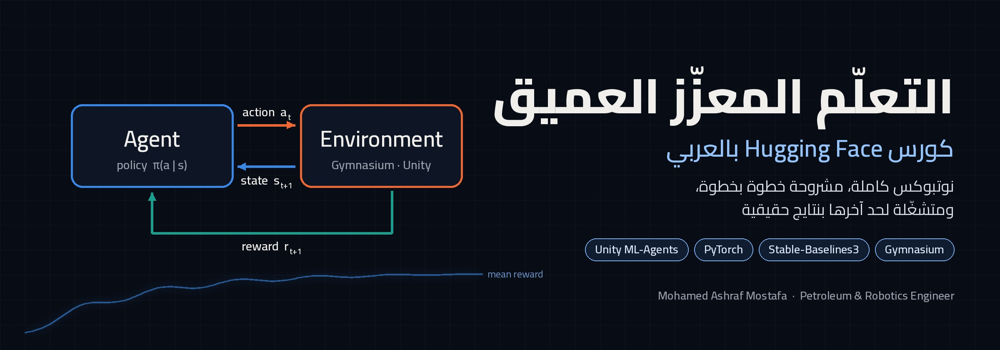

<p align="center">
  
</p>

<p align="center">
  
  
  
  
  
</p>

## عن الريبو

هنا نوتبوكس كورس [Hugging Face Deep Reinforcement Learning](https://huggingface.co/learn/deep-rl-course) بالشرح العربي.
كل نوتبوكس متشغّلة من أولها لآخرها، والنتايج الحقيقية محفوظة جواها: الأرقام، والرسوم، وفيديوهات الـ `agent` وهو بيلعب.
الشرح بالعربي، والمصطلحات بالإنجليزي زي ما هتلاقيها في أي مرجع أو كود.

كل نوتبوكس ليها حلقة فيديو بتشرحها خطوة بخطوة، والروابط هتتضاف جنب كل وحدة أول ما تتنشر.

## الحلقات

| # | الحلقة | الوحدة في الكورس | النوتبوك |
|---|---|---|---|
| 1 | يعني إيه `Reinforcement Learning`؟ الـ `agent` والـ `environment` والـ `RL loop` على `LunarLander` | Unit 1 | [](https://colab.research.google.com/github/mmmohamedaaashraf/deep-rl-arabic/blob/main/ep01-what-is-rl/ep01_what_is_rl.ipynb) · [GitHub](ep01-what-is-rl/ep01_what_is_rl.ipynb) |
| 2 | الـ `Reward` والـ `Return` والـ `Discounting`، ومين الـ `PPO` ده | Unit 1 | [](https://colab.research.google.com/github/mmmohamedaaashraf/deep-rl-arabic/blob/main/ep02-discounting/ep02_discounting.ipynb) · [GitHub](ep02-discounting/ep02_discounting.ipynb) |

فيديوهات الحلقات على [YouTube](https://www.youtube.com/@MmmohamedAaashraf)، وبننزل حلقات جديدة بشكل مستمر إن شاء الله.

## الخطة

8 وحدات (20 حلقة). كل وحدة: حلقة أو اتنين نظري بأمثلة كود، وبعدها حلقة مشروع كامل من الصفر للآخر.

| الوحدة | الموضوع | المشروع |
|---|---|---|
| 1 | أساسيات `Deep RL` | `PPO` على `LunarLander` بـ `Stable-Baselines3` |
| 2 | `Q-Learning` | `FrozenLake` و `Taxi` من الصفر بـ `NumPy` |
| 3 | `Deep Q-Learning` | `DQN` على `Space Invaders` + ضبط بـ `Optuna` |
| 4 | `Policy Gradient` | `REINFORCE` بـ `PyTorch` على `CartPole` و `Pixelcopter` |
| 5 | `Actor-Critic` و `PPO` | `PPO` من الصفر بأسلوب `CleanRL` على `LunarLander` |
| 6 | الروبوتات والتحكم المستمر | ذراع `Panda` بـ `SAC` + `HER`، وروبوت `MuJoCo` بيمشي |
| 7 | `RL` للنماذج اللغوية | تدريب `Qwen` بـ `GRPO` و `TRL` |
| 8 | المتقدم + مشروع التخرج | بيئة حفر من الصفر بـ `Gymnasium` وتدريب `PPO` و `SAC` |
| بونص | `Multi-Agent` و `self-play` | `Unity ML-Agents`: `Pyramids` و `SoccerTwos` |

## تشغيل النوتبوكس

أسهل طريقة: دوس على زرار `Open in Colab` جنب الحلقة، وبعدين `Runtime > Run all`. أول خلية بتسطّب المكتبات لوحدها،
والحلقات الأولى شغالة على الـ `CPU` العادي.

ولو هتشغّل على جهازك:

```bash
git clone https://github.com/mmmohamedaaashraf/deep-rl-arabic.git
cd deep-rl-arabic
pip install swig
pip install "gymnasium[box2d]" stable-baselines3 imageio imageio-ffmpeg matplotlib jupyterlab
jupyter lab
```

## ترتيب الملفات

```
deep-rl-arabic/
├── ep01-what-is-rl/     نوتبوك الحلقة 1 + موديل الـ PPO المتدرب + train_ppo.py
├── ep02-discounting/    نوتبوك الحلقة 2
├── assets/             صور الريبو والخطوط
├── LICENSE             Apache License 2.0
└── NOTICE              مصدر المحتوى الأصلي والتعديلات
```

## المصدر والرخصة

المحتوى مبني على [Hugging Face Deep RL Course](https://huggingface.co/learn/deep-rl-course) و
[`huggingface/deep-rl-class`](https://github.com/huggingface/deep-rl-class)، المنشور برخصة `Apache-2.0`.
النوتبوكس هنا مترجمة ومشروحة بالعربي، ومعدّلة ومتشغّلة بنتايجها، والتفاصيل في ملف [`NOTICE`](NOTICE).
الريبو كله منشور برخصة [`Apache-2.0`](LICENSE). خط `Cairo` المستخدم في الصور منشور برخصة `SIL OFL 1.1`.

## عندك سؤال؟

اكتبه في كومنت على الفيديو، أو ابعتهولي:
[LinkedIn](https://www.linkedin.com/in/mohamed-ashraf0) · [Facebook](https://www.facebook.com/MohamedAshrafIN) · [YouTube](https://www.youtube.com/@MmmohamedAaashraf)

<p align="center"><sub>Mohamed Ashraf Mostafa · Petroleum & Robotics Engineer</sub></p>
